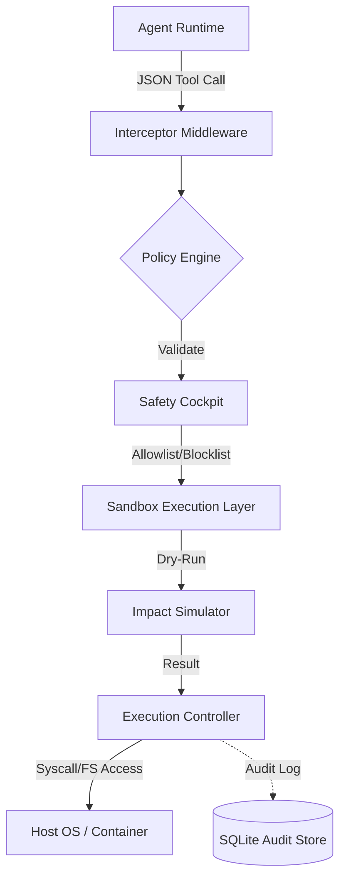

# ARCHITECTURE.md: SkillAction Sandbox

## 1. High-Level System Topology

The SkillAction Sandbox operates as a middleware interceptor between the LLM Agent and the Host OS. It enforces a "Policy-as-Code" paradigm where every tool invocation is treated as an untrusted transaction.



## 2. Tech Stack Rationale

*   **Python 3.11+**: Leverages `TaskGroup` for concurrent safety checks and `TypeAlias` for strict schema enforcement.
*   **Pydantic v2**: Utilizes Rust-based core for high-performance validation of complex nested tool arguments.
*   **FastAPI**: Asynchronous, high-throughput interface for agent communication; leverages `Depends` for dependency injection of policy contexts.
*   **SQLite (with WAL mode)**: Provides ACID-compliant, zero-config audit logging without the overhead of a dedicated database server.
*   **Tailwind (Safety Cockpit)**: Decoupled UI layer for policy visualization, ensuring security rules are human-readable and auditable.
*   **Abstract Base Classes (ABC)**: Enforces strict interface contracts for `ToolProvider` and `PolicyValidator` implementations.

## 3. Module & Directory Layout

```text
/src
├── core/
│   ├── interceptor.py      # Main FastAPI middleware/entrypoint
│   ├── validator.py        # Pydantic-based schema enforcement
│   └── sandbox.py          # Process isolation and syscall monitoring
├── policies/
│   ├── engine.py           # Logic for allowlist/blocklist evaluation
│   └── schemas.py          # Policy definition models
├── tools/
│   ├── base.py             # Abstract Tool interface
│   └── registry.py         # Dynamic tool discovery and registration
├── storage/
│   ├── database.py         # SQLite connection and migrations
│   └── models.py           # Audit log schemas
├── ui/                     # Tailwind/FastAPI static assets
└── utils/
    ├── path_resolver.py    # Path traversal prevention logic
    └── logger.py           # Structured logging
```

## 4. Data Flow & Component Interaction Pipeline

1.  **Ingestion**: The `Interceptor` captures the incoming tool request.
2.  **Normalization**: The `Validator` maps raw JSON to a Pydantic model defined by the specific tool's schema.
3.  **Boundary Inspection**: The `PathResolver` performs canonicalization on all file-system arguments to prevent directory traversal attacks (e.g., `../` injection).
4.  **Policy Evaluation**: The `PolicyEngine` queries the `SafetyCockpit` ruleset. If the action violates a blocklist or exceeds permission scope, the request is rejected immediately.
5.  **Simulation**: If permitted, the `ImpactSimulator` executes a dry-run (e.g., `ls` or `stat` instead of `rm` or `write`).
6.  **Execution**: Upon successful simulation, the `ExecutionController` dispatches the command to the host, wrapped in a restricted subprocess environment.
7.  **Persistence**: Every step (Request -> Policy Check -> Result) is committed to the SQLite audit store.

## 5. Security & Boundary Isolation

*   **Path Sandboxing**: All file operations are restricted to a `SANDBOX_ROOT` environment variable. Any attempt to resolve a path outside this root triggers a `SecurityViolationError`.
*   **Command Allowlisting**: Only explicitly registered functions are executable. The system rejects any dynamic shell execution (e.g., `os.system`, `subprocess.run` with `shell=True`).
*   **Argument Sanitization**: Pydantic models enforce strict regex patterns for all string arguments, preventing command injection via shell metacharacters.
*   **Resource Constraints**: The `ExecutionController` utilizes `resource` module (Unix) to limit CPU time, memory usage, and file descriptor counts for every tool invocation.
*   **Immutable Audit Log**: The SQLite store is configured with a trigger-based append-only policy, ensuring that even if an agent is compromised, the audit trail remains intact for forensic analysis.