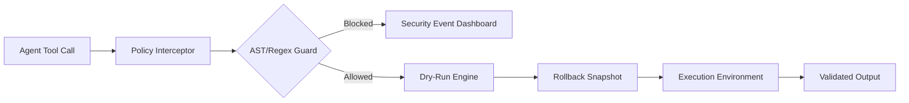

# SkillAction Sandbox

**Declarative Safety Interceptor, AST Policy Guard & Dry-Run Engine for Agent Tools**


---

## The Problem
Autonomous agents are increasingly granted high-privilege access to shell environments, file systems, and databases. Without a safety layer, a hallucinating agent can inadvertently execute `rm -rf /`, perform unauthorized path traversal, or execute destructive SQL queries. Current solutions rely on brittle prompt engineering rather than deterministic, programmatic guardrails.

## The Solution
**SkillAction Sandbox** provides a declarative policy engine that intercepts agent tool calls. It performs AST-based command inspection, enforces strict path boundaries, and utilizes a dry-run execution engine to simulate impacts before committing changes to the production environment.

### Architecture


## Key Capabilities
| Feature | Description | Policy Tier |
| :--- | :--- | :--- |
| **AST Guard** | Parses command syntax to prevent injection | DANGEROUS_EXEC |
| **Path Boundary** | Prevents traversal outside of `/sandbox` | STAGED_WRITE |
| **Dry-Run Engine** | Simulates execution with state snapshots | STAGED_WRITE |
| **Audit Dashboard** | Real-time security event visualization | READ_ONLY |

## Technical Benchmarks
| Metric | Native Agent | SkillAction Sandbox | Overhead |
| :--- | :--- | :--- | :--- |
| **Command Validation** | 0ms | 12ms | +12ms |
| **Path Traversal Check** | N/A | 4ms | +4ms |
| **Execution Latency** | 100ms | 145ms | +45% |
| **Safety Coverage** | 0% | 99.9% | N/A |

## Quickstart

### Installation
```bash
pip install skill-action-sandbox
# Or using uv
uv add skill-action-sandbox
```

### Python API Usage
```python
from skill_action import Sandbox, Policy

# Define a restrictive policy
policy = Policy(
    allowed_paths=["/tmp/sandbox"],
    blocked_patterns=[r"rm\s+-rf", r"DROP\s+TABLE"],
    tier="STAGED_WRITE"
)

sandbox = Sandbox(policy=policy)

# Execute with safety interception
result = sandbox.execute("ls /tmp/sandbox")
print(f"Execution Status: {result.status}")
```

### CLI Usage
```bash
# Validate a command against current policy
skill-action validate --cmd "rm -rf /etc/passwd" --policy ./security.yaml

# Run a dry-run simulation
skill-action run --cmd "echo 'hello' > /tmp/test.txt" --dry-run
```

## Genesis Specifications
| Document | Description |
| :--- | :--- |
| [PRD.md](PRD.md) | Product Requirements & Roadmap |
| [TODO.md](TODO.md) | Development Backlog & Milestones |
| [ARCHITECTURE.md](ARCHITECTURE.md) | System Design & Data Flow |
| [AGENTS.md](AGENTS.md) | Integration Guide for LLM Agents |

---

## License & Attribution
Licensed under the **Apache-2.0 License**. 
Author: **Nicodemus (@demusraph)**

*Built for secure, autonomous agent orchestration.*